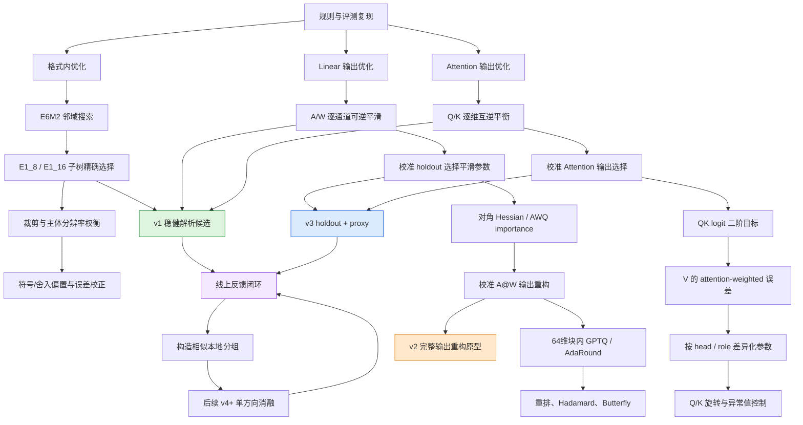
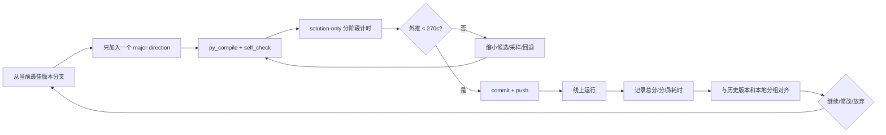

# HiF4 优化路线图

## 总体优化图

## 策略全集与执行决策

| ID | 优化策略 | 主要论文依据 | 本题落点 | 复杂度/风险 | 当前决策 |
|---|---|---|---|---|---|
| F1 | 合法 E6M2 多候选 | HiF4、Four Over Six、OAS/MBS | 每 64 元素块搜索 scale | 候选数直接影响耗时 | v1 已实现 |
| F2 | E1 层级精确选择 | HiF4、M2XFP、MX+ | 精确选择 E1_8/E1_16 子树 | 中等算力，无 state | v1 已实现 |
| F3 | 受控 clipping/overflow | Four Over Six、OAS、OmniQuant | 搜索更小/更大 E6，平衡 outlier 与主体 | 尾部 case 可能负分 | v4 候选 |
| F4 | 非最近舍入 | AdaRound、GPTQ、BRECQ | mant 上下舍入或误差反馈 | 离散搜索成本高 | v5 候选 |
| F5 | 正负非对称处理 | AFPQ、BASE-Q、OS+ | 符号相关 scale/舍入偏置 | HiF4 无双 scale | 仅做偏置近似 |
| L1 | A/W 可逆平滑 | SmoothQuant、AWQ、OmniQuant | `A/s` 与 `W*s` | 校准失配 | v1 已实现 |
| L2 | 输出感知选择平滑 | OmniQuant、BRECQ | calibration `A@W` 选择 alpha | 允许但可能过拟合 | v2/v3 已实现 |
| L3 | 对角 Hessian | GPTQ、AWQ、AdaRound | 激活二阶矩加权 Weight 误差 | 低成本、近似粗 | 待线上单独消融 |
| L4 | 64维块协方差 | GPTQ、MR-GPTQ、QuIP | `e^T H e` 选择层级与舍入 | state 无增加，校准较重 | v4/v5 |
| L5 | 误差反馈/坐标更新 | GPTQ、QuIP | 块间 residual 顺序补偿 | 容易超 300 秒 | 限制一轮/抽样 |
| L6 | 通道重排 | RPTQ、DuQuant、RRS | A/W 同 permutation，聚合同量级通道 | 在线 gather 成本 | 先静态 permutation |
| L7 | Hadamard 旋转 | QuaRot、QuIP#、SmoothRot、RRS | A/W 成对旋转，抑制 spike/outlier | 在线 O(K log K) | 线上证实 outlier 后启用 |
| L8 | learned butterfly/affine | SpinQuant、ButterflyQuant、AffineQuant | 校准学习可逆变换 | 优化与在线成本高 | 后期高风险分支 |
| L9 | runtime smooth | RRS | 当前 A 动态分组统计 | 缺少 GEMM 后 scale 接口 | 只迁移统计思想 |
| T1 | Q/K 逐维互逆平衡 | SmoothQuant、QuaRot | `Q/s`、`K*s` 保持 logits | 校准分布变化 | v1 已实现 |
| T2 | Attention 输出选择 | BRECQ、OmniQuant | calibration attention MSE 选 alpha/gain | v2 太慢 | v3 proxy 已实现 |
| T3 | logit 二阶近似 | GPTQ、InputBreakQuant | 用 softmax Jacobian 加权 Q/K 误差 | 推导与实现复杂 | v5 候选 |
| T4 | V attention-weighted | InputBreakQuant、HiF4-RL | 用校准 attention probability 加权 V token | 测试 token 不同 | 只存低维 head 统计 |
| T5 | role/head 差异化 | HiF4-RL、QuaRot | Q/K/V 使用不同候选范围和目标 | 超参增多 | v4 候选 |
| T6 | Q/K rotation | QuaRot、SpinQuant、DuQuant | head 内 Hadamard/rotation | 必须保持 head 对齐 | 后期分支 |
| R1 | outlier/zero-collapse 诊断 | HiF4-RL、OS+、RRS | 统计 block 峰均比、零率、符号偏斜 | 无线上数据时无法对齐 | 收到反馈后构造数据 |
| R2 | 坏样本聚类 | InputBreakQuant | 按版本线上趋势构造本地分组 | 需要多次线上结果 | 持续维护 |
| X1 | residual/混精度 | ARCQuant、SpQR、DecDEC、TetraJet-v2 | 需要额外表示或 GEMM | 接口不兼容 | 放弃 |
| X2 | 码本/扩维/LoRA | AQLM、QuIP#、Model Expansion、RILQ | 需要自定义码本、shape 或训练 | 接口不兼容 | 放弃 |
| X3 | 训练期无偏量化 | Quartet II、TetraJet、Training MXFP4、QeRL、QAD | backward/蒸馏/RL | 无训练入口 | 仅保留理论参考 |

## 按部就班的版本执行顺序

| 阶段 | 版本/方向 | 唯一主要变量 | Acceptance criteria | 失败回退 |
|---|---|---|---|---|
| 1 | v1 首次线上基线 | F1+F2+L1+T1 | 合法；耗时 <300 秒；记录总分及 Linear/Attention | 官方基准包装版 |
| 2 | v3 输出感知 | L2+T2，其他保持 v1 | 相对 v1 总分提升且耗时 <300 秒 | v1 |
| 3 | v4 RRS 优先分支 | L6+L7；参赛选手反馈线上收益最佳 | 严格等价；耗时 <270 秒；线上分项不劣化 | v1 |
| 4 | v5 二阶重构 | L3/L4/T3，每次只启用一项 | 得分提升覆盖额外校准耗时；外推 <270 秒留余量 | 上一最佳版本 |
| 5 | v6 RRS 消融 | permutation、block size、random sign、post-rotation smooth 每次只改一项 | 确认 v4 收益来源并降低耗时 | v4 或上一最佳版本 |
| 6 | v7 精细舍入 | F4/L5 | 只用于最敏感 block，收益/耗时比优于全局搜索 | 上一最佳版本 |

## 每轮固定流程

## v7 之后的第二轮精读队列

详细推导和接口适配见 [`second-pass-research.md`](second-pass-research.md)。
已进入代码的论文仍有哪些机制未落地，见 [`used-paper-gap-audit.md`](used-paper-gap-audit.md)。

| 顺序 | 论文方向 | 单一主要变量 | 父版本选择 | 失败回退 |
|---|---|---|---|---|
| v8 | DuQuant | Attention peak-balanced zigzag permutation | v7 高于 10314 则用 v7，否则用 v6 | 父版本 |
| v9候选 | DuQuant | 第二次 block rotation | 仅在 v8 正收益时进入 | 最佳单旋转版本 |
| v9候选 | RRS/QuIP# | 扩展 deterministic sign 候选 | v8 无收益时进入 | v6/v7 最佳 |
| 后续诊断 | BASE-Q | mean/clipping-aware 候选排序，不引入 bias state | 最佳 Attention rotation | 不满足严格等价则放弃 |
| 后续 Linear | AdaRound | 固定 Weight 的敏感 block 非最近舍入 | v1 Linear + 最佳 Attention | v1 Weight |

## 临时冲榜门槛（2026-08-29记录）

- 第一名：35715分/389秒；当前合规最佳v236：27060分/238秒。
- v237若低于27160，则在8月31日前启用完整W强拟合冲榜分支。
- 冲榜方向不再做候选数量微调，而采用`Y=A@Wᵀ`教师下的预条件量化最小二乘、残差反投影和mant/scale联合投影；目标运行时间350–405秒。
- 8月31日无状态Linear接口确认后，该临时分支作废，切换到固定`Q0(A)`下校准优化`Q(W)`的路线。
| 后续 Linear | GPTQ | 64维 sampled covariance 单轮 residual | AdaRound 有正收益后 | 最佳 AdaRound |

### Linear 优先队列（用户指定）

v10 完成线上验证后暂停 Attention 扩展，固定线上最佳 Attention，仅迭代 Linear：

| 版本 | Linear 唯一主要变量 | 论文依据 | Acceptance criteria | 回退 |
|---|---|---|---|---|
| v11 | holdout + proxy 输出感知 alpha 搜索 | SmoothQuant、OmniQuant、BRECQ；复用 v3 Linear 思路 | 高于组合父版本且 <300 秒 | v1 Linear |
| v12 | E6 offset 集的校准输出选择 | Four Over Six、OAS/MBS | 相比 v11 提升，且不增加在线 state | v11/v1 Linear |
| v13 | 敏感 block mant 上/下邻级 | AdaRound | sampled-row A@W 重构改善覆盖额外校准成本 | 最佳 scale 版本 |
| v14 | 64维 sampled covariance 单轮 residual | GPTQ、MR-GPTQ | 高于 AdaRound 父版本且 <300 秒 | 最佳 AdaRound |

Attention 的 RRS/QuIP#、BRECQ、SmoothQuant/OmniQuant 未完成项保留在 DAG 中，但在上述 Linear 队列完成前不继续扩展。每版仍只改变一个主要变量。

### Linear 五版本收口（v18–v22）

v17 之后不再为单个小超参拆版本。剩余可合法落地的 Linear 机制压缩为五个主题候选；每版内部可以校准选择少量子策略，但必须保留父版本精确回退。所有在线 `Q(A)` 使用的 Weight 派生信息只能来自最终 HiF4 量化权重 `W_hat`，不得携带或恢复原始 Weight 的低秩补偿，也不得反求测试输出。

| 版本 | 主题与覆盖策略 | 主要论文 | 计算预算与合规边界 | 失败回退 |
|---|---|---|---|---|
| v18 | Activation policy：量化 Weight 对角 importance、mant threshold、按 peak/RMS/zero-collapse 选择保守 E6 policy | AdaRound、Four Over Six、HiF4-RL、RRS | 冻结组级策略；测试阶段只读取 `W_hat` 派生标量/向量，不做 `A@W` | v17 若高于12809，否则v16 |
| v19 | Quantized-Weight low-rank Gram：`W_hat^T W_hat ≈ D + U U^T`，补足 v15/v16 的非对角输出敏感度 | GPTQ、QuIP、MR-GPTQ | rank 从4/8中校准；只优化 `||(Q(A)-A)W_hat^T||²`；动态外推目标 <270秒 | 最佳 v18/当前最高分 |
| v20 | Weight 64维局部二阶编码：协方差加权 E6/E1、细粒度 clipping 与正则化局部 AdaRound | GPTQ、AWQ、OAS/MBS、OmniQuant、BRECQ | 最多128行×128 token；不构造4k Hessian；不做跨块顺序 residual | 最佳 v19/当前最高分 |
| v21 | 新论文固定 Weight 校准：64维 OBQ inverse-Hessian 误差传播、敏感候选与符号非对称舍入 | OBC/OBQ、SqueezeLLM、BitDistiller | 补偿只固化进 `Q(W)`；state 不保存原始 W/Hessian；测试不反解输出 | 线上13006/186，相比v20负收益，放弃并回退v20 |
| v22 | 稳健联合收口：完整保留v20，再用独立validation fold回退不稳定局部块，整层不优则精确回退v20 | SmoothQuant、OmniQuant、BRECQ、GPTQ | 不融合v21或历史负收益rotation；最终 self-check 22/22、总耗时 <300秒 | 当前最高分v20 |

五版完成后停止扩展新的 Linear 论文类别：SpQR/ARCQuant/DecDEC 残差旁路、AQLM/QuIP# 码本、RILQ/LoRA、训练/蒸馏方法和原始 Weight 输出反解均按接口或规则边界永久排除。v23–v28只继续加深合法校准覆盖与已有正收益机制，不引入这些不兼容类别。

### 合法校准空间深挖（v23–v28）

| 版本 | 单一主变量 | 父节点/回退 |
|---|---|---|
| v23 | 分层输出行：均匀、高Weight能量、高当前量化残差，最多256行 | v20 |
| v24 | 最终Q(W)派生的每64块精确对角+rank-8 Gram因子，动态按输出误差选择三种mant舍入；线上13636/190，当前最高分 | v20 |
| v25 | block Gram目标下联合选择中央、offset=-1/3三套E6/E1 metadata及各自三种mant舍入；线上13648/194 | v24 |
| v26 | 最终Q(W)的16个跨块对齐输出行，一轮累计输出残差坐标下降；线上13300/201，因行采样过拟合放弃 | v25 |
| v27 | 32桶CountSketch覆盖Q(W)全部输出行；线上13372/195，仍负收益，停止跨块近似 | v25 |
| v28 | 回到v25独立块路径，将Q(W) Gram因子从rank-8扩大到rank-16 | v25 |

### v29 合规吸收高分工程框架

| 模块 | v29实现 | 合规处理 |
|---|---|---|
| Linear变换 | RMS balance、形状门控排列、sign/Hadamard | state只保存系数/排列/sign，不保存Weight表示 |
| Weight编码 | 校准Q(A)固定、能量排序、窗口32岭回归残差反馈、受门控交替更新 | 全部在校准期完成，最终只返回Q(W) |
| Activation输出度量 | block low-rank + 最高rank-2048 global projection | 两者均在最终Q(W)固定后重新生成 |
| 动态搜索 | 8套完整scale/E1/mant树、能量顺序、2–3轮坐标下降、64行chunk | 目标严格为`||(A-Q(A))Q(W)^T||²` |
| 策略门控 | 多校准布局比较baseline与Q(W)-global | 真实A@W仅用于校准选择，测试state不携带其表示 |

### v30 格式内论文机制补齐

| 机制 | 论文依据 | v30实现 | 预算控制 |
|---|---|---|---|
| 更完整块内Gram | GPTQ、MR-GPTQ、QuIP | Q(W)块投影rank从4提升至16 | 只增加校准state精度，不扩大全局rank-2048上限 |
| 受控饱和 | Four Over Six、OAS/MBS、OmniQuant | 全局E6候选加入offset=-1，由Q(W)输出误差裁决 | 仅增加1棵候选树 |
| 任务感知舍入 | AdaRound、BRECQ | 中央尺度增加mant阈值0.375/0.625 | 不与全部scale做笛卡尔积，仅增加2棵候选树 |

v29线上17552/201已确认整框架；v30候选总数由8增至11。本地32×4096/rank-256单轮smoke中，目标由4.822564e2降至4.818264e2，核心搜索耗时由0.034秒增至0.040秒，但线上仅16717/211，相比v29下降835分。结论是更低的压缩Q(W)代理目标不等于更好的未见Activation泛化，v30组合整体放弃。

### v31 rank-16干净消融

v31从v29重新分叉，只把块内Q(W)度量rank从4改为16。全局rank-2048、8棵RTN scale树、扫描轮数、Weight编码和变换均与v29完全一致；v30的offset=-1及两个非最近邻舍入候选全部删除。该版用于判断v28曾验证的rank收益能否独立迁移到v29框架。

### 按日期切换数据集优先级

| 时间 | Linear题数 | Attention题数 | 研发策略 |
|---|---:|---:|---|
| 2026-08-28更新前 | 250 | 50 | 冻结Attention，只优化Linear到极致 |
| 2026-08-28更新后 | 250 | 250 | 冻结最佳Linear，只优化Attention；重新验证全部Attention候选 |
| 2026-08-31规则调整后（v300回执确认） | 50 | 250 | Linear/Attention按1:5题量建模；安全或接口失败按-100/题计，300题全部未得分为-30000 |

日期优先级高于版本表：若到2026-08-28尚未完成v28，则停止继续扩Linear，按当前版本号直接进入Attention单变量迭代。

## 线上反馈最小字段

每次至少提供：版本、Git commit、线上总分、Linear 分数、Attention 分数、总耗时、是否出现非法输出/超时。若平台只有总分和耗时，也照常记录，不补造分项。

## 完整 W 新限制后的路线更新（2026-08-30）

`docs/max_opt.md` 新增论文的原文复核、数学目标勘误和实验优先级见 [`docs/max-opt-integration-20260830.md`](docs/max-opt-integration-20260830.md)。主线更新为：

1. 等待 v270 线上结果，继续执行“本地预测下界至少 +200 才出版本”。
2. Linear 优先验证 ZeroQuant-V2/LoRC 的 rank-8 `W-Q(W)` 全局 warm-start。
3. 再用 SliM-LLM 的 salience 将固定 HiF4 下的搜索轮数重新分配给可恢复收益最高的块。
4. Atom 的 per-token 动态量化改写成精确 `AW^T` 目标下的条件 clipping/candidate breadth。
5. QServe/LLM.int8 的混合位宽不符合固定 HiF4 输出格式，只吸收保护范围、异常块识别和计算预算思想。
6. Attention 的 SmoothAttention 已有旧集负向记录，仅在固定 Linear 后对新增 200 题作独立复验。
